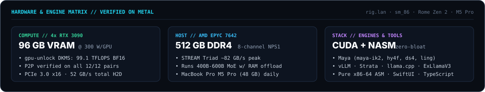

  

  
  
  
  

## Who I Am

Infrastructure lead by day. By night I tear open MoE inference engines, write CUDA kernels and pure x86-64 assembly, abliterate and quantize frontier open-weight models, and benchmark everything on a hand-built **4x RTX 3090 (96 GB VRAM) + 512 GB 8-channel EPYC rig**.

Most local-AI advice online is written by people guessing from vibes or assuming everyone owns an H100. I run it on 2020 consumer cards, keep the raw JSON traces and exact launch flags, and ship whatever actually moves the needle.

---

## Top Repositories

### 1. Inference & Optimization

| Repository | Stars | What It Does |
|---|---:|---|
| [**inference-optimization-playbook**](https://github.com/alesha-pro/inference-optimization-playbook) |  | **97 tested hypotheses** on making 100B-600B MoE models fast on consumer GPUs (4x RTX 3090 + experts in RAM): what worked, what failed, and why. Comes as a human playbook + coding-agent skill. |
| [**llm.asm**](https://github.com/alesha-pro/llm.asm) |  | **100% pure x86-64 NASM assembly, zero C, zero libc:** Qwen3-0.6B inference engine (**12 KB**), bare-metal bootable LLM OS (**22 KB**, verified on Proxmox), and from-scratch Mini-GPT trainer with live Braille TUI (**32 KB**). |
| [**vllm-cross-model-kv**](https://github.com/alesha-pro/vllm-cross-model-kv) |  | Cross-model KV cache transfer in vLLM: a smaller model prefills, a bigger one answers directly from its cache (independent implementation of arXiv:2608.03893, measured on 2x RTX 3090). |

### 2. Maya Inc. & Custom CUDA Engines

| Repository / PR | Stars | What It Does |
|---|---:|---|
| [**maya-inkling-mini**](https://github.com/alesha-pro/maya-inkling-mini) |  | **Inkling 2 Mini on a single RTX 3090:** **129.5 tok/s** decode (up to **210 tok/s** with DSpark), **344K context**, vision and tools. Custom `maya-ik2` engine keeping every expert in 24 GB VRAM (2.3x decode / 3.7x prefill over `llama.cpp`). |
| [**project-maya**](https://github.com/alesha-pro/project-maya) |  | Project Maya fork + upstream CUDA engine work ([`maya-ling`](https://github.com/mw00/project-maya/pull/1224) for Ling-3.2-air, [`maya-hy4f`](https://github.com/mw00/project-maya/pull/1068) Hy4-Flash TP+CPU lane, [`maya-ds4`](https://github.com/mw00/project-maya/pull/811) DeepSeek prefill +29-72%, and runtime refusal projection `STRATA_GLM_ABLATE`). |

### 3. Tools, Apps & Builders

| Repository | Stars | What It Does |
|---|---:|---|
| [**tools**](https://github.com/alesha-pro/tools) |  | My flagship toolbox from the 4x 3090 rig: production ComfyUI workflows, local-AI model setups, agent skills, and benchmark configs. |
| [**atlas**](https://github.com/alesha-pro/atlas) |  | Interactive canvas that dissects an LLM tensor by tensor: measured INT8 / INT4 / FP8 quantization error, weight distributions, spectra, and outlier channels across all 1,199 tensors. |
| [**redcast**](https://github.com/alesha-pro/redcast) |  | Open-source, agent-native Raycast replacement for macOS in SwiftUI: real Raycast extensions, local models, voice dictation, screen awareness, and ACP coding agents without paywalls. |
| [**bench-portal**](https://github.com/alesha-pro/bench-portal) |  | Playable browser-game benchmark portal: 3D scenes, shaders, and mini-games built autonomously by frontier LLMs, filterable by model. [Live](https://bench-portal.pages.dev) |
| [**claude-memory-bridge**](https://github.com/alesha-pro/claude-memory-bridge) |  | Share live per-project Claude Code memory across Antigravity CLI, Factory Droid, Codex, Cursor, OpenCode, and Windsurf via MCP, plus nightly Auto-Dream consolidation. |

### 4. Benchmarks & Reproducible Releases

| Repository | Stars | What It Does |
|---|---:|---|
| [**evalatro**](https://github.com/alesha-pro/evalatro) |  | Open benchmark where language models play real Balatro end-to-end. |
| [**4x3090-llm-benchmarks**](https://github.com/alesha-pro/4x3090-llm-benchmarks) |  | Public archive of local LLM speed measurements from the rig with exact launch commands and per-run provenance. |
| [**qwen38-flashnext-strata-4x3090**](https://github.com/alesha-pro/qwen38-flashnext-strata-4x3090) |  | Qwen3.8-Flash-Next on 2x RTX 3090: 150 tok/s on code, 262K context with Strata 0.2.10 + DFlash2 + refusal vectors. |

---

## Hugging Face (565,000+ Downloads / 30d)

My quants, runtime refusal vectors, and custom GGUF/EXL3 builds live at [**huggingface.co/alesha-pro**](https://huggingface.co/alesha-pro):

- [**Qwen3.8-Flash-Next-abliterated-GSQ-RCO-Strata-GGUF**](https://huggingface.co/alesha-pro/Qwen3.8-Flash-Next-abliterated-GSQ-RCO-Strata-GGUF): **385,000+ downloads (30d)** · Uncensored Qwen3.8 Flash-Next for Strata with runtime control-vector projection.
- [**Hy4-flash-Uncensored-GGUF**](https://huggingface.co/alesha-pro/Hy4-flash-Uncensored-GGUF): **119,000+ downloads (30d)** · Tencent Hy4-Flash (220B MoE) uncensored build running at 262K context + vision on consumer cards.
- [**GLM-5.3-Flash-abliterated-Maya-M-GGUF**](https://huggingface.co/alesha-pro/GLM-5.3-Flash-abliterated-Maya-M-GGUF): **36,000+ downloads (30d)** · Mixed-quant abliterated build tuned to saturate 4x RTX 3090 (96 GB VRAM).
- [**Qwen3.8-27B-S-mirai-GGUF**](https://huggingface.co/alesha-pro/Qwen3.8-27B-S-mirai-GGUF): **3,200+ downloads (30d)** · 2.4-bit Mirai S in 12 GB VRAM with vision projector and refusal vector.

---

## The Rig

  

---

## Selected Engineering & X Highlights

- [**NVIDIA sold millions of 3090s with half the tensor speed switched off**](https://x.com/superalesha/status/2113332444283691105) (`672K+ views`): One kernel module (`gpu-unlock`) lifted my BF16 tensor pipe from 64.4 to **99.1 TFLOPS** at 300 W with bit-exact outputs.
- [**Inkling 2 Mini at 129.5 tok/s on ONE RTX 3090**](https://x.com/superalesha/status/2124102269138346409) (`50.7K+ views`): Built a custom `maya-ik2` CUDA loop keeping every expert in 24 GB VRAM with 344K context (**2.3x decode / 3.7x prefill** over `llama.cpp`).
- [**Open-sourced 97 tested MoE optimization hypotheses**](https://x.com/superalesha/status/2124128158072922512) (`61.2K+ views`): 4+ months of empirical profiling on 400B-600B MoE models across 4x RTX 3090 + 512 GB 8-channel RAM.
- [**512K context in 0.8 GB of VRAM on DeepSeek V4.1-Flash 1017**](https://x.com/superalesha/status/2115845365446439273) (`40.1K+ views`): 500K prompt prefill at **1,804 tok/s**, 39.7 tok/s decode on 4x RTX 3090.
- [**Introducing Redcast: Free, Open-Source Raycast for macOS**](https://x.com/superalesha/status/2122986286239580609) (`67.4K+ views`): Native SwiftUI launcher with local models, voice, and real extensions.
- [**Pure x86-64 Assembly LLM Trilogy (`llm.asm`)**](https://x.com/superalesha/status/2125563464424862044): 12 KB Qwen3-0.6B inference binary, 22 KB bare-metal OS booting on Proxmox, and 32 KB trainer with live Braille TUI. Zero C, zero libc.

---

## Live GitHub Telemetry

  <picture>
    <source media="(prefers-color-scheme: dark)" srcset="https://streak-stats.demolab.com?user=alesha-pro&amp;hide_border=true&amp;background=090d14&amp;stroke=1e293b&amp;ring=34d399&amp;fire=22d3ee&amp;currStreakLabel=34d399&amp;sideLabels=94a3b8&amp;dates=64748b&amp;currStreakNum=f8fafc&amp;sideNums=f8fafc">
    
  </picture>
  <picture>
    <source media="(prefers-color-scheme: dark)" srcset="https://github-profile-summary-cards.vercel.app/api/cards/stats?username=alesha-pro&amp;theme=github_dark">
    
  </picture>

  Every number on this page comes from a real run. If it is not in a repo with raw traces, I did not ship it.

