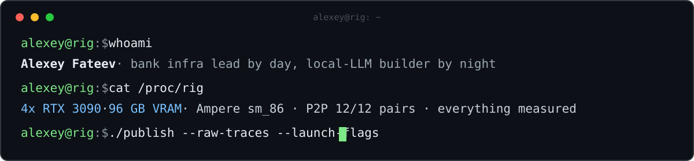

  

  <a href="https://x.com/superalesha"><b>X / @superalesha</b></a> ·
  <a href="https://huggingface.co/alesha-pro"><b>Hugging Face</b></a> ·
  <a href="https://alesha.pro"><b>alesha.pro</b></a> ·
  <a href="https://t.me/fuckup_files"><b>t.me/fuckup_files</b></a>

## About

By day I run infrastructure. The rest of the time I bench LLMs on a hand-built 4x RTX 3090 rig with 96 GB of VRAM, and I publish every measurement with raw traces and per-run provenance attached. People argue about quants and reasoning effort from vibes. I run the thing and count.

## Featured work

| Project | Stars | What it is |
|---|:---:|---|
| [**tools**](https://github.com/alesha-pro/tools) |  | Things I build while running models on my own hardware: ComfyUI workflows, model setups, agent skills and benchmark configs from the rig |
| [**atlas**](https://github.com/alesha-pro/atlas) |  | Interactive canvas that takes an LLM apart tensor by tensor. It measures INT8/INT4/FP8 error, distributions, spectra and outlier channels on every weight tensor |
| [**bench-portal**](https://github.com/alesha-pro/bench-portal) |  | A catalog of games, 3D showcases and shader experiments built by AI models, filterable by the model that built them. [Live](https://bench-portal.pages.dev) |
| [**evalatro**](https://github.com/alesha-pro/evalatro) |  | The open benchmark where language models play real Balatro |
| [**llama.cpp-mirai-s**](https://github.com/alesha-pro/llama.cpp-mirai-s) |  | llama.cpp with Mirai S support: a 2.4-bit Qwen3.8-27B in 12 GB of VRAM with 128K context, plus refusal removal at run time |
| [**qwen38-flash-next-4x3090**](https://github.com/alesha-pro/qwen38-flash-next-4x3090) |  | Qwen3.8 Flash Next AWQ INT4 on 4x RTX 3090: 262K context, vision, FP8 KV cache and CUDA Graphs |
| [**redcast**](https://github.com/alesha-pro/redcast) |  | An agent-native, Raycast-style launcher for macOS. My fork of Tinycast with native and ACP agents, voice and screen awareness |
| [**4x3090-llm-benchmarks**](https://github.com/alesha-pro/4x3090-llm-benchmarks) |  | Public archive of local LLM speed measurements from the rig, with exact launch commands and per-run provenance |
| [**vllm-cross-model-kv**](https://github.com/alesha-pro/vllm-cross-model-kv) |  | Cross-model KV cache transfer in vLLM: a smaller model prefills, a bigger one answers from its cache |

## Models on Hugging Face

My quants, abliterations and engine builds live at [huggingface.co/alesha-pro](https://huggingface.co/alesha-pro).

- [**Qwen3.8 Flash Next Abliterated: EXL3 and Strata GGUF**](https://huggingface.co/collections/alesha-pro/qwen38-flash-next-abliterated-exl3-and-strata-gguf-6ac0da3fdaa11b99c2c146db): the uncensored Qwen3.8 Flash-Next for Strata and exllamav3, over 220,000 downloads.
- [**GLM-5.3-Flash on 4x RTX 3090**](https://huggingface.co/collections/alesha-pro/glm-53-flash-on-4x-rtx-3090-6aca78f8275cbe99db02a6a9): GLM-5.3-Flash quants and the abliterated Maya build that fit four 24 GB cards.
- [**Qwen3.8-27B-S-mirai-GGUF**](https://huggingface.co/alesha-pro/Qwen3.8-27B-S-mirai-GGUF): Mirai S in 12 GB of VRAM, with the vision projector and the refusal vector.

## The rig

The rig is 4x RTX 3090 with 96 GB of VRAM in total. P2P is verified on all 12 pairs, the cards run at 220 W each on PCIe 3.0 x16. Engines on the box: vLLM, llama.cpp, exllamav3 + tabbyAPI, plus SGLang when it behaves. Ampere sm_86 has no native FP8, and most quant advice out there assumes everyone owns a Hopper. I enjoy measuring what actually wins on these cards.

## Highlights from X

- [NVIDIA sold millions of 3090s with half the tensor speed switched off](https://x.com/superalesha/status/2113332444283691105). One kernel module took my BF16 tensor pipe from 82 to 155 TFLOPS, with outputs matching the stock run byte for byte.
- [DeepSeek just published the price of a token](https://x.com/superalesha/status/2112653788574339075). 155 trillion tokens a day at $38 of revenue per GPU-hour: at these prices, serving a frontier-class model is a very profitable business.
- [110,409 downloads in 9 days](https://x.com/superalesha/status/2110062105692926352) for the uncensored Qwen3.8 Flash-Next I put up for Strata. My part was a 480 KB file and a weekend of measuring.
- [A 27B model in 12 GB of VRAM](https://x.com/superalesha/status/2107896192591945829). Mirai S Qwen3.8-27B at 2.4 bits per weight: full 262K context, 70 tok/s, and now uncensored.
- [Local AI performance is a software problem](https://x.com/superalesha/status/2111885825218838905). A 2020 RTX 3090 runs Qwen3.8 27B up to 4.6x faster, and nobody bought a thing.
- [My RTX 3090 made these while I was asleep](https://x.com/superalesha/status/2107748850005864633). 103 images and 63 clips overnight with Qwen-Image-2.1 and MiniMax H3. No cloud, no credits, no queue.

## Numbers

  <picture>
    <source media="(prefers-color-scheme: dark)" srcset="https://streak-stats.demolab.com?user=alesha-pro&amp;hide_border=true&amp;theme=github-dark-blue">
    
  </picture>
  <picture>
    <source media="(prefers-color-scheme: dark)" srcset="https://github-profile-summary-cards.vercel.app/api/cards/stats?username=alesha-pro&amp;theme=github_dark">
    
  </picture>

---

Every number on this profile comes from a real run. If it is not in a repo with raw data, I did not say it.
